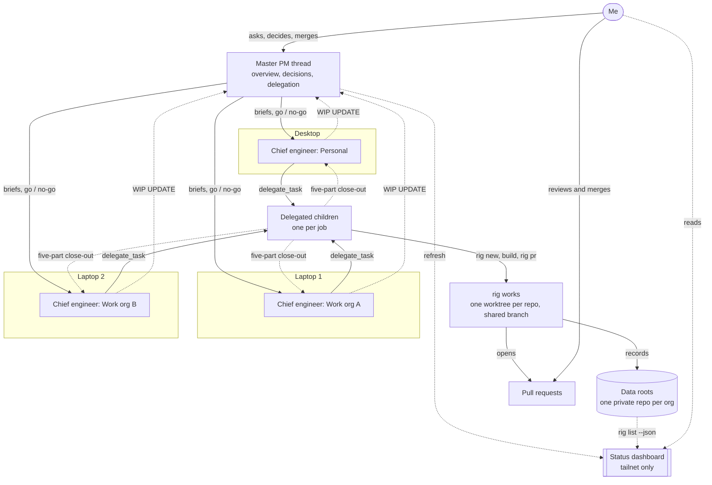
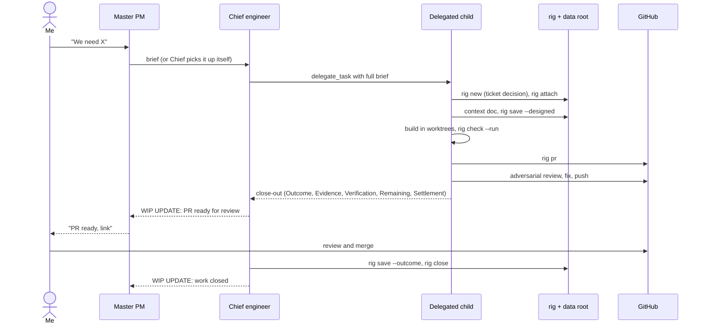
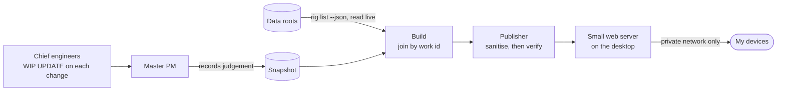

# How I work with AI agents

A walk-through of the setup I use to run coding agents across several organisations and machines: who does what, where the knowledge lives, and the rules that keep it safe. Each section below is one slide.

The tools named here are [T3 Code](https://github.com/pingdotgg/t3code) (the agent host), [rig](https://github.com/hugoforte/rig) (my cross-repo work harness, public) and [dotfiles](https://github.com/hugoforte/dotfiles) (my machine and agent config, public). Organisations are called "Personal", "Work org A" and "Work org B" throughout.

---

## 1. The problem

- **Many repos.** A single piece of work often touches two or three repos at once: an API, a web app, an infra repo.
- **Several orgs.** Personal projects plus two employers or clients. Each has its own GitHub org, its own tracker (GitHub Issues, Jira or Linear), its own git identity and its own Claude account. Knowledge from one must never leak into another.
- **Several machines.** A Windows desktop and two laptops, one of them a Mac. Each org's work tends to live on one machine.
- **Agents forget.** A chat session ends and its context is gone. The next one starts from zero unless the knowledge was written down somewhere durable.
- **Too many chats.** With a dozen agents running, I become the bottleneck: every one of them wants my attention, and I lose track of which one is waiting on me.

The setup below answers each of these: worktrees for many repos, one data root per org, linked machines, durable work records, and a hierarchy of threads so that only one of them talks to me.

---

## 2. The pieces

| Piece | What it is | Lifetime |
|---|---|---|
| **T3 Code** | The agent host. Runs agent threads (Claude, Codex) on each machine, links machines together, lets threads message each other, delegate to child threads and run scheduled tasks. | Always on |
| **Master PM thread** | One thread I talk to. It keeps the overview of every work in every org, keeps the dashboard current and does no hands-on work: it delegates. | Long-lived |
| **Chief-engineer threads** | One per org, each on the machine where that org's work lives. Triages, decides, starts and closes works, and reports every material change to the Master PM. Also does no hands-on building. | Long-lived |
| **Delegated children** | Short-lived threads a chief or the PM starts for one job: build a work, fix review findings, refresh the dashboard. They hand back a close-out and are settled. | Minutes to hours |
| **rig** | A CLI that sets up one git worktree per repo for a piece of work, all on one shared branch, and keeps that work's record. Ships its own agent skills. | Per work |
| **Data roots** | One private git repo per org holding rig's knowledge: the repo catalogue, the org doc and every work's record. | Permanent |
| **dotfiles + overlays** | A public repo of machine and agent config (instructions, skills, hooks, settings) plus private overlay repos for what cannot be public. Symlinked into place and synced on a schedule. | Permanent |

---

## 3. The whole picture



Solid arrows are instructions going down; dotted arrows are status coming back up. I only ever talk to the Master PM thread (and occasionally a chief). Everything else reaches me through it.

---

## 4. How the threads talk

All of this is T3 Code features, not custom code:

- **Threads** are agent conversations. Each one has a provider and model, a project folder and a history.
- **Linked environments** join machines: a thread on the desktop can read, message or start a thread on a laptop. The Master PM on the desktop reaches each chief on its own machine this way.
- **Thread-to-thread messages** carry the reports. A chief sends one line per changed work to the PM:

  ```text
  WIP UPDATE | <org> | <work> | <old -> new> | next: <action> | blocker/ask: <none or ask> | links: <URLs> | observed: <timestamp>
  ```

  Only material changes are sent (a PR opened, checks failed, a blocker appeared, a work closed), never a "still working" heartbeat.
- **Delegated children** are threads a parent starts with a brief. The child wakes its parent when it finishes, and its final message is the hand-back.
- **Settling** a thread marks it done, so the inbox shows only threads that need me.
- **Scheduled tasks** run a prompt on a timer, such as refreshing the dashboard every 15 minutes.

---

## 5. rig: the unit of work

rig's unit is a **work**: one piece of work, possibly across several repos, on one branch name everywhere. Three places hold it:

| Root | Holds | Committed? |
|---|---|---|
| The tool | rig itself, generic and public | Yes, public |
| The data root | The knowledge: `catalog/` (one entry per repo: what it is, how to verify it), `orgs/` (the org doc: what hurts now, what we're trying to accomplish, whose call it is), `work/<id>/` (each work's `context.md`, `work.json` and `notes.tsv`), and `rig.json` (orgs and their trackers) | Yes, private, one per org |
| The work root | The worktrees and bare mirrors | No: disposable, deleting it loses nothing |

Each org gets its own data root because each has different readers. A work lives in exactly one, and rig refuses to mix repos from different roots into one work. The context doc is the one place prose about a work lives; everything derivable (branch state, PR state, phase) is computed live by `rig status` and never written down, so it cannot go stale.

---

## 6. The life of one piece of work

1. **`rig new`** creates the work and records the ticket decision: an existing key, a new ticket, or explicitly none. rig refuses to start without that decision.
2. **Pick the repos** (`rig prompt select-repos`, then `rig attach`). Each gets a worktree on the work's branch. A repo rig has not seen gets a draft catalogue entry to fix while the repo is fresh.
3. **Write the context doc**: Problem, Direction, Status. The Direction is agreed with me (or decided by the agent and marked so), then recorded with `rig save --designed`, including whether the PRs get an adversarial review.
4. **Build** in the worktrees. A big work can be sliced into **stages**, each a branch stacked on the work branch with its own PR. `rig stage --land` merges reviewed stages into the work branch, never further.
5. **Verify** with `rig check --run`, which runs each repo's catalogued checks and records which patch passed.
6. **`rig pr`** opens one PR per repo, its body lifted from the context doc's "Pull request" section (summary, evidence, merge danger).
7. **Review**: an adversarial review by a separate agent that tries to break the change and fixes what it finds, then the review threads are worked through and automated reviewers' threads resolved.
8. **I merge.** Always a human.
9. **Outcome and lessons**: `rig save --outcome` records what changed for someone and why it is good; the lesson review offers each lesson a home (a repo, the catalogue, the org doc, rig itself).
10. **`rig close`** comments the PR links on the tickets, deletes merged branches, removes the worktrees and keeps the context doc. The child that did the work is settled.

At any point, `rig next` reads the live state and says what is available next.



---

## 7. Agent config as code

Every machine gets the same agent behaviour because the config is a git repo, not something set by hand:

- **Global instructions.** A `CLAUDE.md` with the rules that hold everywhere (fail fast, commit hygiene, no merging, how to write docs) lives in the public dotfiles repo and is symlinked into `~/.claude/`. Personal working rules (how to use rig, where notes go) come from a private overlay as a rules file beside it.
- **Skills.** Each skill is a folder with a `SKILL.md`, linked into every agent host's skills directory: my own (`hf-*`, for example adversarial review or resolving PR comments), vendored ones, and rig's (`rig-*`: handoff, lessons, digest, user docs, reading pages for big PRs, retros). A skill whose text names anything private ships from a private overlay instead.
- **Overlays** are cut by audience, not secrecy: one for me only, one that could be handed to an employer as is.
- **A guard hook.** `agent-guard` runs before every shell command an agent issues. It refuses writing files through heredocs or editing in place with `sed -i` / `perl -i` (they mangle quotes and backslashes), and it asks me before any PR merge, from any shell.
- **Encrypted skill secrets.** Credentials a skill needs are committed encrypted with SOPS and age, one recipient per machine plus a recovery key kept offline. A deploy script decrypts them once per machine into a protected store and links them into the checkouts that use the skill. A secret never passes through chat, a prompt or a command line; the agent uses the skill that reads it.
- **Sync.** A scheduled task on each machine pulls the repos and relinks everything, so a change made on one machine reaches the others within hours. A `--check` mode reports drift without changing anything.

---

## 8. The rules that keep it safe

| Rule | Why |
|---|---|
| **I merge.** No agent merges a PR; the guard hook asks before any merge command. rig itself only merges reviewed stages into a work branch. | Merging is where review turns into production. |
| **External messages need my approval of the exact text.** A chat post, an email or a message to a colleague is drafted, shown to me word for word, and only then sent. | Anything sent outside cannot be taken back. |
| **Closing needs me to name it.** A PR, issue, ticket or work is closed only when I named that item for that act. "Check which can close" means report only. | A wrong close loses work or confuses colleagues. |
| **Children are settled with a five-part close-out**: Outcome, Evidence (links), Verification (what was actually run), Remaining work, Settlement reason. | The last message is a durable record; the inbox only shows what needs me. |
| **Secrets only via skills.** Stored encrypted, reached only through the skill that uses them; never pasted into chat, prompts, files or command lines. | Transcripts are kept; a pasted secret has leaked. |
| **Low-impact decisions are just made.** The agent decides, says so, and records it as its own decision, not as my agreement. | Asking about everything makes me the bottleneck again. |
| **Always links.** Every PR, issue, ticket, thread or run mentioned gets its full URL, never a bare `#123`. | One click, from anywhere, to the real thing. |
| **One org's knowledge stays in its data root.** Separate repos, separate identities, separate accounts. | Different readers; no cross-org leaks. |

---

## 9. The dashboard: what it shows

One page answers "where is everything?" across all three orgs, so I never have to ask a thread for a status.

- **One card per open work**: its org, its phase, its PRs and tickets as links, what happens next and any blocker.
- **Your actions**: a list at the top gathers every item where the next step is mine (a review, a decision, a merge, an approval). It is the first thing I read.
- **Freshness per org**: each org's section shows when its chief last reported, and turns stale after a day without a report, so a quiet chief is visible instead of looking like "nothing happening".
- **Open in T3**: every card links straight to the thread that owns the work.

---

## 10. The dashboard: where the data comes from

Two sources, kept apart on purpose:

| Source | Holds | Changes when |
|---|---|---|
| **Chief reports** | Judgement: status, next step, blocker, what is asked of me | A chief sends a WIP UPDATE and the Master PM has it recorded in a snapshot |
| **rig's records** | Facts: whether the work exists, its last activity, its repos, whether it closed | Read live from every data root (`rig list --json`) on each rebuild |

The build joins the two by work id and flags a card when rig says the work closed or was abandoned while its chief still reports it open. rig stays the authority for durable state; the snapshot carries only what a chief judged.



---

## 11. The dashboard: current and private

**How it stays current**

- **Event-driven.** Each WIP UPDATE makes the Master PM delegate a child that updates the snapshot, rebuilds the page and republishes it, so a change shows within minutes.
- **A fallback refresh.** A scheduled task rebuilds every 15 minutes from rig's records alone, in case a report was missed. It never changes a chief's judgement, and it speaks up only when something moved or a step failed.
- **Auto-reload.** An open page reloads itself every minute.

**Private by design**

- **Reachable only on my private network.** The name resolves to a private address, so off that network it leads nowhere; there is no public route and no login page to attack.
- **Sanitised before it is served.** The page is built locally and never served as built. A publisher strips local paths and commands, rewrites thread links to the T3 web client, refuses anything it does not recognise, swaps the page in atomically, then fetches it back and checks the served bytes and headers.
- **A locked-down page.** Its content security policy blocks every outgoing connection, form and frame, and nothing is cached.

---

## 12. The dashboard: the Action Queue idea

Concept only: today the queue on the page is a preview, and every button but "Open in T3" is disabled.

The aim is to work through my items from the page itself: pick a card, choose an action ("ask for an update", "hold"), move to the next, and send now or as a batch. How it is meant to stay safe:

- **Two locked-down service accounts.** One takes requests from the page, the other delivers them. Each is an ordinary local account that reads only its own code, config and keys, and cannot reach my repos, work records or secrets.
- **A drop box between them.** The receiving side can only add items to a queue; the delivering side can only take them. Every item is signed and checked again by the side that reads it, so writing to the queue alone delivers nothing.
- **Fixed messages to fixed threads.** A request names an action and a work. Delivery checks it against its own allowlist and sends one of a fixed set of messages to an allowlisted thread, so even a compromised sender cannot write its own text.
- **Shadow mode until I say "enable".** In shadow, every delivery goes to a harmless drill thread, which acknowledges it, whatever the request named. Delivery to the chiefs is a separate switch that needs my recorded decision.
- **Fail closed.** If the receiving side is down, the page is simply read-only, as it is today.

---

## 13. What works well, what's still rough, how to start

**What works well**

- **The record survives the chat.** Any session, on any machine, can pick a work up from its context doc, `rig status` and the handoff note. Nothing important lives only in a transcript.
- **One inbox.** I talk to one thread and read one page. Children settle themselves; chiefs report only changes.
- **Worktrees per work.** Parallel works never fight over a checkout, and deleting the work root loses nothing.
- **Review by a second agent.** The adversarial review hunts for what is wrong with a PR, and fixes it, before a human reviewer spends time on it.
- **Config as code.** A new machine is a clone and a setup script away from behaving like the others.

**What's still rough**

- **Usage limits stop threads mid-flight.** A long-lived thread that hits a spend cap simply fails; a fresh thread has to take over from a handoff note.
- **A busy thread can't listen.** While a thread runs a long task, incoming messages wait. The fix so far is more delegation, so the long-lived threads stay idle and responsive.
- **Threads I start myself don't wake the chief** when they finish, so the chief has to sweep for unsettled threads on every turn.
- **Acting from the dashboard** (queueing an instruction to a thread from the page) exists only in shadow mode; for now I still type replies in T3.
- **Catalogue drift.** Repo entries fall behind their repos; `rig doctor` flags it, but someone has to update them.

**How to start small**

1. Install rig with one data root and one repo. Use only `rig new`, `rig pr` and `rig close` for a week, and write the context doc as you go.
2. Put your global agent instructions in a git repo and symlink them into place, so every machine and session gets the same rules.
3. Add one guard hook for the mistake you hate most (mine: an agent merging a PR).
4. Once you have several works open, add one long-lived thread per org that delegates the building to children and asks for a close-out from each.
5. Add the PM thread and a dashboard last, only when there are too many chiefs to read.
